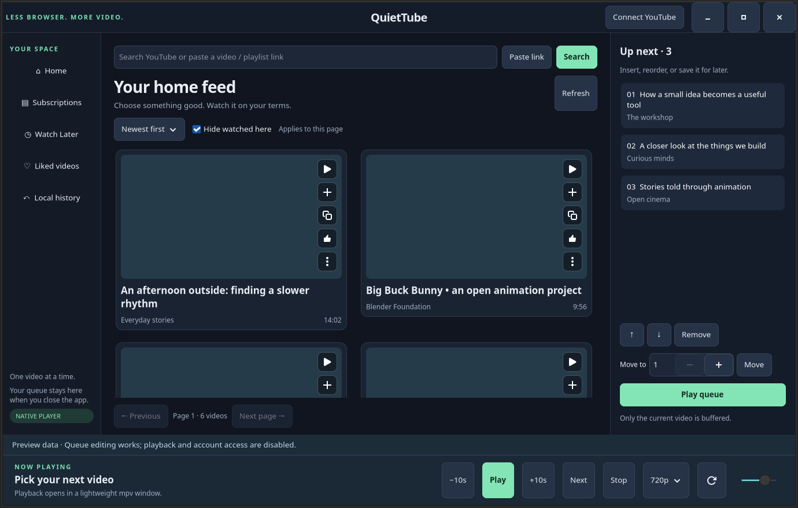

<div align="center">


# QuietTube

**Your videos. A little more breathing room.**

A native Linux YouTube companion with a persistent playback queue and mpv.
Part of [Quiet](https://github.com/quiet-desktop-apps) · [MIT](LICENSE)
</div>



*Real application screenshot with an offline sample feed. Playback/account access
are disabled in demo mode; the screenshot does not expose a personal feed.*

## Why QuietTube?

Watching a queue of videos should not require keeping a browser session open.
QuietTube uses Python and GTK4 for browsing, short-lived yt-dlp workers for
extraction, SQLite for your queue/history, and one mpv player for video.
There is **no Chromium, Electron or embedded webview**.

Memory stays explicit: one page of at most 30 videos, a bounded thumbnail cache,
disposable extraction workers, and player buffers capped at 64 MiB forward / 8 MiB
backward. These are component limits, not a total memory cap.

A repeated-feed regression stabilized around **199–203 MiB UI RSS** after warm-up
across 200 replacements. A separate public 720p playback check measured
**253–265 MiB mpv RSS**, excluding the UI and extractor. These were different
workloads and must not be added into a claimed measured total. **We do not yet have
a controlled Chromium comparison for QuietTube.** See [memory evidence](docs/memory.md).

## What it does

- Browse Home, Subscriptions, Watch Later and Liked videos with your connected
  session; search public videos, open links and browse playlists.
- Keep an editable queue: play now, add next, insert, reorder and remove.
- Save playback position locally; resume, seek, reload a stalled stream and
  select a resolution ceiling (720p by default).
- Show publication ages and hide locally completed videos; newest-first ordering
  applies within each loaded page.
- Like a video through an explicit account action, confirmed before showing success.
- Use native GTK controls and a separate mpv video window. Playback works with the
  browser closed after browser-assisted account connection.

## Install from source on Linux

Requires Python **3.11+**, GTK4 **4.8+**/PyGObject, mpv and Node.js **20+** for current
YouTube extraction. On Ubuntu/Debian:

```bash
sudo apt install git python3 python3-venv python3-pip python3-gi gir1.2-gtk-4.0 mpv nodejs
# Check node --version is 20 or newer.
git clone https://github.com/quiet-desktop-apps/QuietTube.git
cd QuietTube
./setup.sh
./run.sh --demo                 # Offline sample interface
./run.sh
.venv/bin/python scripts/install_desktop.py
```

The installer adds a user-local Applications entry linked to this checkout. Keep
the checkout in place. No signed binary packages or automatic updates are provided
yet. Update a clean checkout with `git pull --ff-only`, run `./setup.sh`, then
restart. See the [full user guide](docs/usage.md) for controls and troubleshooting.

## Account connection and limits

**Current implementation: browser-session import. Personal OAuth configuration is
a proposed direction, not a released feature.**

**Connect YouTube** opens the real sign-in page in your regular browser. QuietTube
then imports your selected browser session locally after you request it, keeping
only YouTube cookies. You can close the browser afterwards. This is browser-assisted
login, not Google OAuth or an embedded login form.

Session cookies are powerful credentials. They are saved unencrypted with private
file permissions outside the repository. Never upload them to an issue. Disconnect
removes the saved session; your local queue/history remain. There is no Quiet-hosted
service. See [architecture and privacy](docs/architecture.md).

QuietTube is **unofficial**, not affiliated with or endorsed by YouTube or Google.
Website/extractor changes and account restrictions can interrupt it. Some restricted,
paid, DRM-protected or bot-challenged videos may not play. Local queue and watch
history are not synchronized back to YouTube. Software decoding is currently the
compatibility default and may use more CPU at high resolutions.

## Why the account connection needs to change

The first implementation proved that a native video wall and queue can work with
the browser closed. It reused an existing YouTube login instead of requiring a
developer registration. GTK displays the feed and mpv plays the video; the browser
does not render either inside QuietTube.

However, closing the browser does not make the copied session independent of it.
Cookies can expire, rotate or be invalidated. Browser-profile permissions and
keyring access can also prevent import. During manual investigation, a saved
session was no longer authenticated even though its file still existed; Home
could return signed-out recommendations, making missing or repeated videos look
like a filtering problem. Reimporting a session can restore access, but creates
the recurring dependency on the browser that we want to remove.

There are separate limitations too: mpv playback does not update YouTube watch
history, and newest-first sorting currently applies only within the loaded page.
Changing authentication alone will not solve those issues or playback failures.

## Direction: personal credentials and freedom to run locally

QuietTube is a personal-use-first, [MIT-licensed](LICENSE) project. You may use,
inspect, modify and redistribute its code under that license. The intended account
model has **no QuietTube server, subscription, bundled Google registration or
shared maintainer quota**. Software freedom does not grant unrestricted access to
Google's services.

The proposed setup is for each person to create their own Google Cloud project,
enable YouTube Data API v3, create a Desktop OAuth client and import its
configuration locally. They then authorize their Google account. Configuration
and user tokens would stay outside GitHub and the source tree. Routine renewal
would use OAuth refresh tokens instead of copied browser cookies; Google sign-in
would still open a browser temporarily and could be needed again after revocation.

**Quota belongs to the Google Cloud project, not the signed-in user or installed
copy of QuietTube.** Different users, devices or OAuth client IDs using one project
share its allowance. Separate personal projects have separate allocations.
For example, 100 users consuming 100 units each would exhaust a shared
10,000-unit daily bucket. Moving requests to a backend would not create more quota.
Google currently documents separate daily defaults of **100 search calls**,
**100 upload calls**, and **10,000 units for other endpoints combined**; these are
not interchangeable buckets or a count of videos you may watch. Check the actual
project allocation, since limits can change.
[Google quota reference](https://developers.google.com/youtube/data/guides/quota_and_compliance_audits)

YouTube Data API usage within its allocation does not require billing. Existing
paid Google Cloud services are separate: check the proposed personal project's
billing association, rather than starting a paid trial or linking a payment
account unnecessarily. Exceeding YouTube quota produces request failures, not an
automatic paid upgrade. Hosting or other paid APIs would be separate costs.
[Billing explanation](https://dev.to/googleworkspace/getting-started-using-google-apis-api-keys-part-2-38i6),
[quota errors](https://developers.google.com/youtube/data/reference/rest/v3/errors)

This direction adds setup work and still has unresolved service-policy and
playback questions. Google requires one API project per API client and prohibits
artificially spreading usage across projects to obtain more quota. We have **not
established that a distributed client requiring personal projects is approved**;
this proposal is not a quota-bypass mechanism. OAuth also does not provide mpv
with supported media streams or reproduce every website feature.
[Google's policy explanation](https://developers.google.com/youtube/terms/developer-policies-guide)

Read the [account direction and trade-offs](docs/account-direction.md) for the
original approach, alternatives, costs, token expiration and remaining work.

## Architecture and Agentic Engineering

[Architecture](docs/architecture.md) · [Engineering process](docs/agentic-engineering.md)
· [Native-client decision](docs/decisions/0001-native-clients.md)
· [Account-direction decision](docs/decisions/0002-personal-account-connection.md)
· [Verification](docs/verification.md)

Humans own product intent, high-level requirements and important technical
decisions. Coding agents implement, test and document within that direction.
The human maintainer owns acceptance and merge authority; required PR checks
protect `master`.

```bash
# Test dependencies; setup.sh must have completed first.
sudo apt install xvfb xauth ffmpeg python3-pil
.venv/bin/python -m pip install -r requirements-dev.txt
./test.sh
```

Tests use synthetic cookies, temporary stores, local generated videos and a virtual
display. Public/live-account checks are separately labelled; opening a feed does
not authorize tests to mutate ratings. [Contributing](CONTRIBUTING.md) · [Security](SECURITY.md)

Original QuietTube code and bundled original assets are [MIT licensed](LICENSE).
Dependencies retain their own licenses: [third-party notices](THIRD_PARTY_NOTICES.md).
Maintained by [Paulo Aboim Pinto](https://github.com/aboimpinto).
