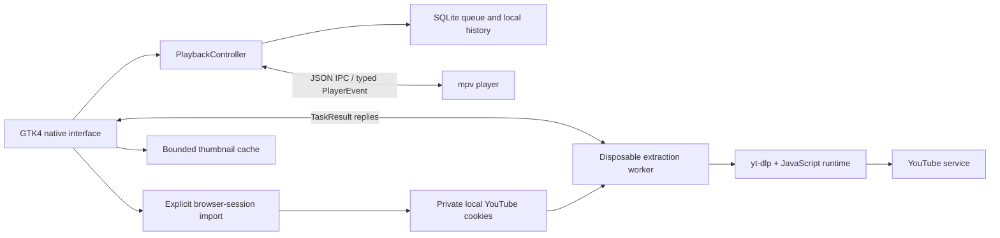

# QuietTube architecture

QuietTube uses Python/GTK4 for the interface, SQLite for local state, disposable
workers for yt-dlp extraction and one mpv process for playback. It does not embed
Chromium or a webview. See [ADR 0001](decisions/0001-native-clients.md).

| Module | Ownership |
|---|---|
| `ui.py` | Native controls, feeds, thumbnails, queue views and user actions |
| `models.py`, `storage.py` | Queue model, bounded local history, SQLite persistence |
| `controller.py` | Playback state transitions and saved positions |
| `player.py` | mpv lifecycle, IPC and typed player events |
| `tasks.py`, `worker.py` | Extraction/session worker lifecycle and completion replies |
| `browsers.py` | Explicit browser/profile discovery for session import |
| `ratings.py` | User-requested Like operation and confirmation |
| `thumbnails.py` | Size/count/concurrency-limited thumbnail downloads |
| `diagnostics.py` | Private bounded playback logs with allowlisted fields |

GTK receives typed `TaskResult` and `PlayerEvent` messages on its main loop.
Generation checks ignore stale results from cancelled work. Only end-of-file
completion advances the queue; errors and closing the player preserve the current
item. Worker termination and player lifecycle completion are explicit, not inferred
from elapsed silence. An independent Like worker is not cancelled by browsing.

## Resource lifetime and bounds

Feeds display at most 30 videos/page and replace the current page. Queries allow
up to 10 pages. The thumbnail cache holds at most 64 compressed images of at most
192 KiB each, with two concurrent requests; only displayed cards hold decoded
textures. Extraction processes exit after each task or are terminated with their
children on cancellation/timeouts. Tasks time out after 90 seconds.

One mpv process runs at a time. Its demuxer buffers are capped at 64 MiB forward
and 8 MiB backward. Decoder, renderer, GPU and process overhead are additional.
Software decoding is currently selected for compatibility; 720p is the default
resolution ceiling. The queue stores metadata for up to 1,000 upcoming items;
local history retains 500 videos. Queue changes save immediately, positions every
five seconds and on pause/normal close. Playback resume is manual after restart.

## Account, privacy and network boundaries

The user signs in through their existing browser and explicitly asks QuietTube
to connect that session. A local worker reads the chosen browser profile, filters
for YouTube cookies, validates access and retains only the necessary YouTube
session. This is not a Google OAuth application or an embedded password form.

Data lives under `$XDG_DATA_HOME/quiettube` or `~/.local/share/quiettube`.
Cookies are plaintext files with `0600` permissions in a `0700` directory;
they are not encrypted at rest. Disposable copies are removed after requests or
playback. Disconnect stops playback and removes saved session/feed thumbnails,
while keeping the local queue and history.

Requests go to the underlying service/media infrastructure. There is no Quiet
backend or analytics service. Public searches, feed extraction, thumbnails and
playback still use the network. Opening a feed does not rate a video; Likes need
an explicit user action and a confirming response. Local queue/history updates
are not synchronized to YouTube.

Private diagnostic logs have three files capped at 1 MiB each. They record bounded
numeric playback states and fixed warning categories, not raw media URLs, cookies,
video IDs or titles. A log is evidence of sampled state, not proof of what caused
an earlier intermittent failure.

## Verification

Tests use synthetic cookies, temporary stores and generated local clips. Real mpv
IPC and GTK controls run in a virtual display. Playback-format tests inspect rendered
local video frames. A 200-feed-refresh regression checks memory after warm-up.
Public-service and account tests are documented separately; a passing offline suite
does not guarantee that YouTube endpoints still work. See [verification](verification.md).
